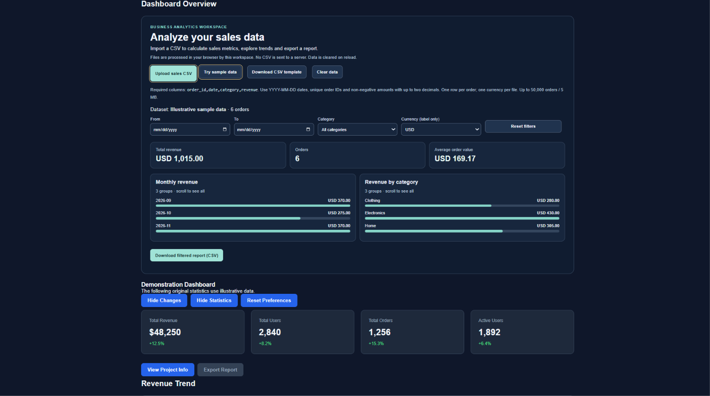

# InsightBoard

A responsive business analytics application that transforms CSV sales records into interactive dashboards and downloadable reports.

## Live Application

[Launch InsightBoard](https://insightboard-sigma.vercel.app)

## Application Preview

The screenshot displays illustrative sample data.

## Key Features

- CSV sales data imports and validation
- Automatic revenue and order calculations
- Average order value analysis
- Monthly revenue visualizations
- Revenue breakdown by category
- Interactive date and category filters
- Multiple currency display labels
- Downloadable CSV reports
- Sample datasets and CSV templates
- Browser-based sales data processing
- Spreadsheet formula injection mitigation
- Responsive desktop and mobile interface
- Demonstration user directory and preferences

## Technology Stack

- Next.js
- React
- TypeScript
- CSS Modules
- Node.js
- Next.js API Routes
- ESLint
- Vercel

## Supported CSV Format

    order_id,date,category,revenue
    ORD001,2026-11-01,Electronics,250
    ORD002,2026-11-02,Clothing,120
    ORD003,2026-11-03,Electronics,180

Each row represents one order.

Use unique order IDs, YYYY-MM-DD dates, non-negative revenue and one currency per file.

Supports up to 50,000 orders and files up to 5 MB.

## Data Privacy

Uploaded sales records are processed in the browser by the analytics workspace and cleared on reload.

Currency selection changes the display label, not the monetary value.

## Local Development

    git clone https://github.com/HasithaGayan/insightboard.git
    cd insightboard/next-app
    npm ci
    npm run dev

Open http://localhost:3000.

## Testing

    npm run lint
    node --test tests/salesAnalytics.test.mjs
    npm run build

With the application running on port 3000, execute:

    npm run test:smoke

## Engineering Verification

- 11 analytics engine tests passed
- 8 application smoke tests passed
- ESLint and TypeScript validation passed
- Production build successful
- CSV imports and filtering verified
- Report exports verified
- Common spreadsheet formula prefixes tested
- Public application functionality verified

## Current Limitations

- Authentication is not implemented.
- Uploaded sales records are not persisted after reload.
- Currency conversion is not supported.
- Original demonstration statistics use illustrative data.
- User directory and feedback are demonstration features.
- Full accessibility compliance has not been audited.

## Developer

Developed by Hasitha Gayan.

AI and Full-Stack Developer | IT Undergraduate

[GitHub](https://github.com/HasithaGayan) |
[Portfolio](https://hasithagayan.github.io/ai-fullstack-87/)