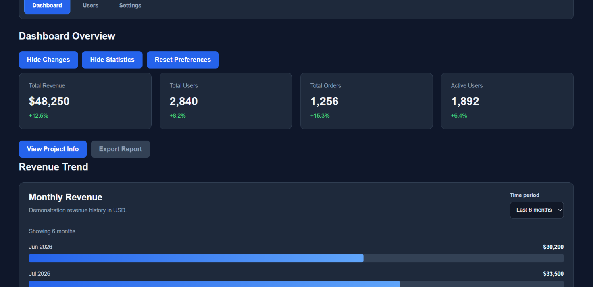
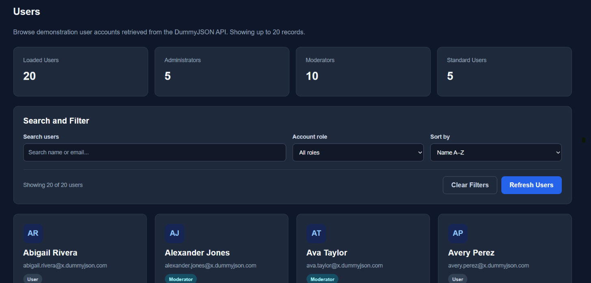
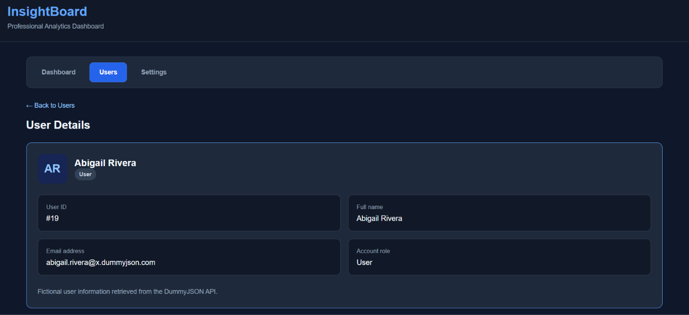
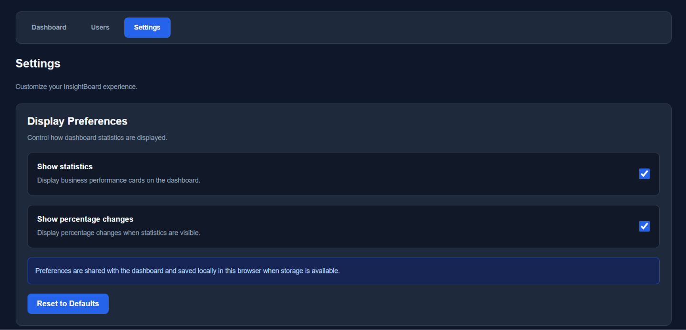
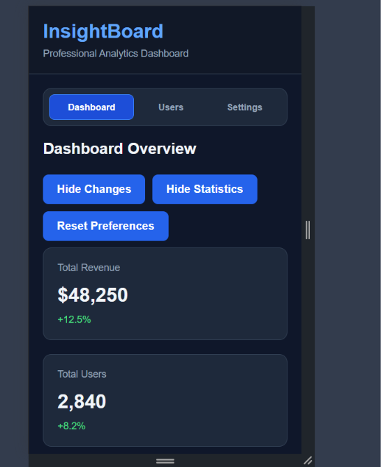

# InsightBoard

**Responsive Business Analytics Dashboard**

## Overview

InsightBoard is a responsive business analytics
dashboard built with React and TypeScript.

It combines reusable components, interactive data
visualization, external API integration, accessible
forms, shared state management and automated
behavioral testing.

## Project Status

- Major Project: 02 of 05
- Started: 19 November 2026
- Development Roadmap: Day 24-40
- Current Milestone: React Frontend V1
- Status: In Development

The React frontend is being prepared for release
before the planned Next.js migration.

## Screenshots

### Dashboard Overview

### API-Powered User Directory

### Dynamic User Details

### Shared Settings

### Responsive Mobile Layout

## Key Features

### Business Dashboard

- Four business performance summary cards
- Interactive monthly revenue chart
- Three-month and six-month period selection
- Configurable statistics visibility
- Configurable percentage changes
- Persistent display preferences
- Project information modal

### Interactive Watchlist

- Add, remove, pause and resume metrics
- Search, filtering and sorting
- Derived summary counts
- Duplicate and empty name validation
- Persistent browser storage
- Reset Watchlist

### User Directory

- External DummyJSON REST API integration
- Up to 20 fetched user records
- Runtime API response validation
- Normalized TypeScript records
- Account role summary cards
- Case-insensitive name and email search
- Role filtering
- Alphabetical and numerical sorting
- Dynamic user details pages
- Loading, success, empty and error states
- Retry and refresh functionality
- Missing-user handling
- Obsolete request cancellation

### Feedback and Support

- Controlled multi-field form
- Independent validation utilities
- Accessible labels and field errors
- Automatic invalid-field focus
- Live character counter
- Simulated asynchronous submission
- Pending, success and failure states
- Duplicate submission prevention
- Data preservation after failure
- Automatic reset after success

### Settings and Navigation

- React Router client-side navigation
- Shared application layout
- Active navigation indicators
- Dynamic routes
- Unknown-route handling
- Shared Preferences Context
- Persistent display settings

### Accessibility

- Semantic HTML
- Keyboard-accessible controls
- Accessible form labels
- Field-specific error associations
- Visible keyboard focus
- Route-change focus management
- Native dialog keyboard support
- Reduced-motion-aware animations
- Numeric labels for chart values

## Technology Stack

| Technology | Version |
| --- | --- |
| React | 19.3.1 |
| TypeScript | 7.0.2 |
| Vite | 8.3.8 |
| React Router | 7.18.6 |
| Node.js | 24.19.0 |
| npm | 11.17.0 |
| Oxlint | 1.94.0 |
| Vitest | 5.1.1 |
| React Testing Library | 16.3.3 |
| Testing Library DOM | 10.4.2 |
| Testing Library User Event | 14.6.13 |
| Jest DOM | 8.0.0 |
| jsdom | 31.0.1 |

Additional technologies:

- CSS Grid and Flexbox
- Fetch API
- AbortController
- Browser localStorage
- React Developer Tools
- Git and GitHub

See versions.md and package-lock.json
for dependency details.

## Application Routes

| Route | Description |
| --- | --- |
| / | Business dashboard |
| /users | Searchable user directory |
| /users/:id | Individual user details |
| /settings | Shared display preferences |
| * | Page not found |

## Architecture

    App
      └── PreferencesProvider
          └── BrowserRouter
              └── DashboardLayout
                  ├── Header
                  ├── Navigation
                  ├── RouteContent
                  │   └── Outlet
                  │       ├── DashboardPage
                  │       ├── UsersPage
                  │       ├── UserDetailsPage
                  │       └── SettingsPage
                  └── Footer

RouteContent manages keyboard focus
during client-side route changes.

The PreferencesProvider remains mounted
across page navigation.

## Project Structure

    insightboard/
    ├── docs/
    │   └── screenshots/
    ├── public/
    ├── src/
    │   ├── components/
    │   ├── context/
    │   ├── data/
    │   ├── hooks/
    │   ├── pages/
    │   ├── services/
    │   ├── test/
    │   ├── types/
    │   ├── utils/
    │   ├── App.tsx
    │   ├── App.test.tsx
    │   ├── App.css
    │   ├── index.css
    │   └── main.tsx
    ├── package.json
    ├── package-lock.json
    ├── vite.config.ts
    ├── vitest.config.ts
    ├── versions.md
    └── README.md

## API Integration

Data source:

https://dummyjson.com/docs/users

Endpoints:

- GET /users?limit=20
- GET /users/:id

The service validates external JSON and
normalizes records before they reach
React components.

### Data Flow

    User Action or Route Change
                |
                v
          useAsyncData
                |
                v
          userService
                |
                v
         External REST API
                |
                v
      Validate and Normalize
                |
                v
         React State Update
                |
                v
       Search / Filter / Sort
                |
                v
         Render Components

AbortController, Effect cleanup and request
identity checks protect the interface against
obsolete asynchronous responses.

## State Management

- Local state for individual features
- React Context for shared preferences
- localStorage for persisted preferences
  and Watchlist records
- Derived data for filters and summary counts

Redux and Zustand are not required for the
current shared-state requirements.

## Revenue Visualization

The chart uses typed demonstration data
and CSS-based horizontal bars.

Bar widths are derived from revenue values
using a consistent maximum-value scale.

The selected time period determines the
visible records without duplicating state.

The chart includes readable currency values,
accessible controls and reduced-motion support.

## Performance Optimization

React DevTools Profiler identified unnecessary
renders caused by dashboard-level modal state.

Modal state was moved into DashboardActions
using state colocation.

### Development Profiler Results

| Measurement | Before | After |
| --- | ---: | ---: |
| Render duration | 7.9 ms | 1.0 ms |
| Passive effects | 5.1 ms | 4.9 ms |

The measured render duration decreased
by approximately 87.3%.

The update owner changed from DashboardPage
to DashboardActions, narrowing the scope
of modal-related updates.

These results represent individual development
Profiler measurements, not a comprehensive
production performance benchmark.

## Automated Testing

Tests use Vitest, React Testing Library,
user-event, jest-dom and jsdom.

External API dependencies are mocked for
deterministic test execution.

Deferred Promises are used to test request races
and obsolete asynchronous responses.

### Frontend V1 Test Inventory

| Test suite | Tests |
| --- | ---: |
| StatCard | 3 |
| FeedbackForm | 5 |
| UsersPage | 8 |
| userService | 10 |
| useAsyncData | 3 |
| RouteContent | 2 |
| RevenueChart | 3 |
| App integration | 3 |
| Total | 37 |

The Day 29 baseline passed all 31 tests.
Run the current test suite to verify the
complete Frontend V1 test inventory.

### Testing Coverage

- Component rendering
- Form validation and interaction
- Accessible error associations
- API response validation
- Loading, empty and error behavior
- Search and role filtering
- Retry functionality
- Request cancellation
- Stale-response protection
- Navigation focus management
- Revenue period selection
- Shared Context integration
- Preference persistence

## Getting Started

### Clone the Repository

    git clone https://github.com/HasithaGayan/insightboard.git
    cd insightboard

### Install Dependencies

    npm ci

### Start Development Server

    npm run dev

### Run Automated Tests

    npm test

### Test Watch Mode

    npm run test:watch

### Lint

    npm run lint

### Type Checking and Production Build

    npm run build

### Preview Production Build

    npm run preview

Open the URL displayed in the terminal.

Windows PowerShell users may use npm.cmd
instead of npm when required.

## Feedback Demo

Use fictional test data only.

- test@example.com: Simulated success
- fail@example.com: Simulated failure

No feedback is transmitted, emailed or stored.

## Development Milestones

| Day | Milestone |
| --- | --- |
| 24 | React components and dashboard foundation |
| 25 | Interactive state and persistent Watchlist |
| 26 | Accessible forms and async submission |
| 27 | Routing and shared Preferences Context |
| 28 | External API integration and filtering |
| 29 | Automated tests and performance optimization |
| 30 | Revenue visualization and Frontend V1 |

## Technical Challenges

- React render purity
- Corrupted localStorage recovery
- Duplicate form submissions
- Windows dependency file locks
- Shared state ownership
- Runtime API response validation
- Asynchronous race conditions
- Unnecessary component rendering
- Client-side navigation focus management

## Deployment Preparation

The production build is generated in dist/.

The hosting platform must support SPA fallback
to index.html for direct React Router URLs.

Production hosting and the Next.js migration
are planned for later development milestones.

## Current Limitations

- Business statistics and revenue use demo data.
- User accounts are fictional API records.
- Filters operate on up to 20 loaded records.
- Feedback submission is simulated.
- Watchlist labels do not represent live monitoring.
- Authentication and report export are not implemented.
- Accessibility compliance is not fully audited.
- The application depends on the external API.
- Public deployment is pending.

## Planned Development

- Next.js migration
- Tailwind CSS
- Additional dashboard functionality
- Production deployment
- Final portfolio case study

## Demonstration

A two-minute Frontend V1 demonstration
is being prepared.

## Developer

Developed by Hasitha Gayan.

Part of an intensive AI and Full-Stack
Web Development learning roadmap.
